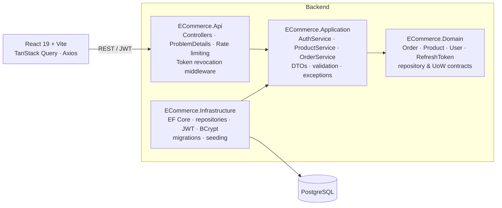
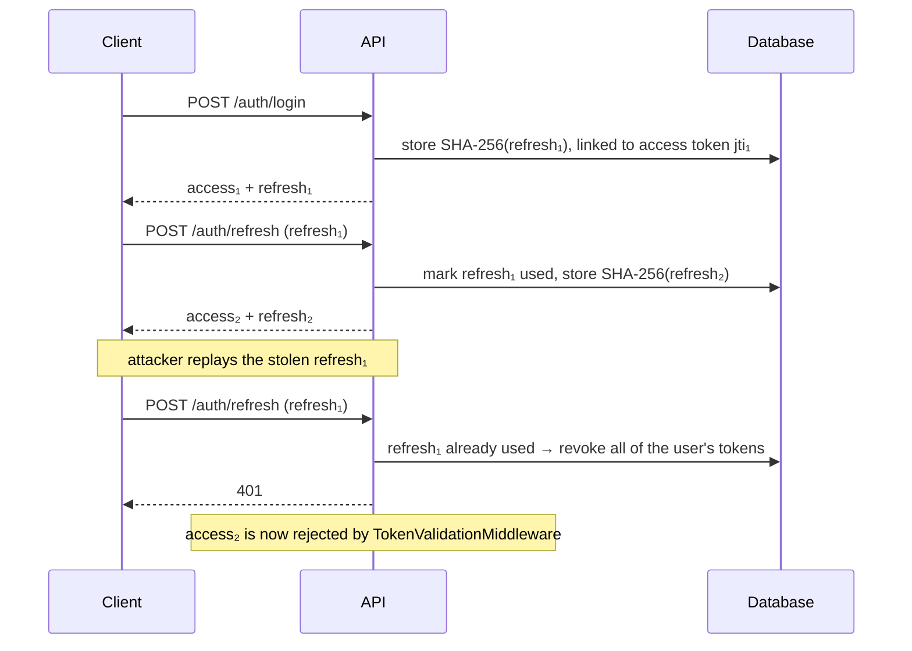

# E-Commerce API — .NET 10 Clean Architecture

[](https://github.com/phinhd/ecommerce-domain-driven-design/actions/workflows/ci.yml)


[](LICENSE)

A marketplace-style REST API where users list products and buy from each other, with a React + TypeScript front end. The focus is on the parts that usually go wrong in real systems: **token security, overselling under concurrency, consistent error contracts and tests that hit a real database.**

## Highlights

- **JWT + refresh token rotation with reuse detection.** Refresh tokens are single-use and stored as SHA-256 hashes. Replaying a used token revokes every session of that user, and revoked sessions are rejected even while their access token is still unexpired.
- **No overselling.** Stock is reserved with one conditional `UPDATE … WHERE quantity >= n` inside the same transaction as the order insert. An integration test fires 8 concurrent orders at 3 units of stock and asserts exactly 3 succeed.
- **Rich domain where it matters.** `Order.Place` captures the unit price at order time and computes totals; `Product` enforces its own invariants (non-negative price/stock, ownership, soft delete).
- **One error contract.** Every failure is RFC 7807 `application/problem+json`, mapped centrally by an `IExceptionHandler`. Controllers contain no `try/catch`.
- **Fail-fast configuration.** JWT settings are validated at startup; a missing or short signing key stops the app.
- **Hardening.** Rate-limited auth endpoints, case-insensitive email handling, `/health` with a PostgreSQL check, non-root Docker image.
- **Tests on real infrastructure.** Integration tests run the actual API, migrations and middleware against PostgreSQL in Testcontainers.
- **CI.** GitHub Actions: backend build with warnings as errors, format check, unit + integration tests; frontend lint + build; Docker image build.

## Architecture



| Project | Responsibility |
| --- | --- |
| `ECommerce.Domain` | Entities with behaviour, repository/unit-of-work/transaction contracts. No framework dependencies. |
| `ECommerce.Domain.Shared` | Enums shared across layers. |
| `ECommerce.Application` | Use cases, DTOs with validation, typed exceptions, settings, clock abstraction. |
| `ECommerce.Infrastructure` | EF Core `DbContext`, repositories, unit of work, JWT and password hashing, migrations, seeding. |
| `ECommerce.Api` | HTTP surface: controllers, auth, exception handling, rate limiting, health checks, Swagger. |

## Getting started

### Option A — Docker Compose (API + PostgreSQL)

```bash
docker compose up --build
```

- Swagger UI: http://localhost:5000
- Health: http://localhost:5000/health
- Migrations and demo data are applied automatically.

### Option B — run the API locally

Requires the [.NET 10 SDK](https://dotnet.microsoft.com/download).

```bash
docker compose up -d postgres
dotnet run --project ecommerce.aspnet/ECommerce.Api
```

Swagger UI: http://localhost:5117 (Development applies migrations and seeds demo data).

### Front end

```bash
cd ecommerce.react
cp .env.example .env      # VITE_API_BASE_URL points at the API
npm ci
npm run dev               # http://localhost:5173
```

### Demo accounts (Development only)

| Email | Password |
| --- | --- |
| `customer1@example.com` | `Password123!` |
| `customer2@example.com` | `Password123!` |
| admin | see `AdminSeedSettings` in `appsettings.Development.json` |

Seven sample products are created; search for "phone" or "laptop".

## API

| Method | Route | Auth | Description |
| --- | --- | --- | --- |
| `POST` | `/api/auth/register` | — | Create a customer account |
| `POST` | `/api/auth/login` | — | Access token (15 min) + refresh token |
| `POST` | `/api/auth/refresh` | — | Rotate the token pair |
| `POST` | `/api/auth/logout` | Bearer | Revoke the current session |
| `GET` | `/api/auth/me` | Bearer | Current user |
| `GET` | `/api/products?search=&page=&pageSize=&mine=&excludeMine=` | optional | Paged, case-insensitive search |
| `GET` | `/api/products/{id}` | — | Product details |
| `POST` | `/api/products` | Bearer | Create a product |
| `PUT` | `/api/products/{id}` | Bearer (owner) | Update a product |
| `DELETE` | `/api/products/{id}` | Bearer (owner) | Soft delete a product |
| `POST` | `/api/orders` | Bearer | Place an order (reserves stock atomically) |
| `GET` | `/api/orders/my` | Bearer | Current user's orders |
| `GET` | `/health` | — | Liveness + database |

Example error:

```json
{
  "type": "https://tools.ietf.org/html/rfc9110#section-15.5.1",
  "title": "Bad request",
  "status": 400,
  "detail": "Not enough stock. Available: 1",
  "instance": "/api/orders"
}
```

## Security design

### Refresh token rotation



- Only hashes are stored, so a database leak does not yield usable refresh tokens.
- Login failures return the same 401 for unknown email, inactive account and wrong password.
- Passwords are hashed with BCrypt (work factor 12).

### Stock reservation

```sql
UPDATE "Products"
SET "Quantity" = "Quantity" - @qty
WHERE "Id" = @id AND "DeletedAt" IS NULL AND "Quantity" >= @qty;
```

Running this inside the order's transaction means a failed insert rolls the reservation back, and PostgreSQL's row lock serialises concurrent buyers, so stock never goes negative.

## Configuration

| Key | Notes |
| --- | --- |
| `ConnectionStrings:DefaultConnection` | PostgreSQL connection string. |
| `JwtSettings:SecretKey` | **Required**, ≥ 32 characters. Use user-secrets or `JwtSettings__SecretKey`; never commit a real key. |
| `JwtSettings:DurationInMinutes` / `RefreshTokenExpiryDays` | Access and refresh token lifetimes (15 min / 7 days). |
| `Cors:AllowedOrigins` | Front-end origins. |
| `Database:ApplyMigrationsOnStartup` | `true` in Development/Compose; run migration bundles from CI/CD in production. |
| `Seed:SampleData` | Demo users and products (Development only). |
| `AdminSeedSettings:Email` / `Password` | Optional admin account. |
| `RateLimiting:AuthPermitLimit` | Auth requests per minute per IP (default 20). |

## Testing

```bash
cd ecommerce.aspnet
dotnet test ECommerce.slnx        # integration tests need Docker running
```

| Suite | Covers |
| --- | --- |
| Unit (`ECommerce.UnitTests`) | Login/registration rules, token rotation and reuse detection, refresh token hashing, order placement and rollback, ownership checks, paging limits, domain invariants |
| Integration (`ECommerce.IntegrationTests`) | Full auth flow incl. replay and logout revocation, 400/403/409 problem responses, case-insensitive search, stock decrement, **concurrent orders never oversell** |

## Design decisions & trade-offs

- **Generic repository + unit of work.** Keeps CRUD consistent and testable. The generic repository returns materialised lists rather than `IQueryable`, so query logic stays inside the specialised repositories.
- **Set-based stock update instead of optimistic concurrency.** One round-trip, no retries, and it needs no schema change. The trade-off is that the tracked `Product` entity is not updated in memory during that request.
- **Server-side revocation check per request.** Adds one indexed lookup per authenticated request in exchange for being able to kill a session immediately.

## Known limitations

- Used and expired refresh tokens are not purged yet; a scheduled cleanup job would keep the table small.
- An order contains a single product line; a cart with multiple lines is the next step.
- Order status transitions (paid, shipped, cancelled) are modelled but not exposed through the API.

## License

[MIT](LICENSE)
