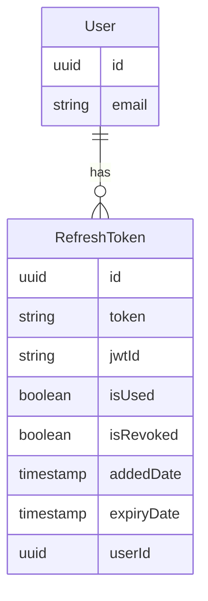

# E-Commerce API Assessment

## Tech Stack

* **Backend**: .NET 10, Entity Framework Core
* **Database**: PostgreSQL
* **Frontend**: React 19, Vite, TypeScript, Tailwind CSS

## Getting Started

### Prerequisites

* .NET 10 SDK (for manual run)
* Docker & Docker Compose
* (Optional, for frontend) Node.js 20+

### Option A: Run with Docker (recommended)

```bash
docker compose up --build
```

API runs at: http://localhost:5000 — Swagger UI: http://localhost:5000/index.html
Database migration and seeding run automatically on startup.

### Option B: Run manually (for local development)

1. Start PostgreSQL:
```bash
docker compose up -d postgres
```


2. Run the API:
```bash
dotnet run --project ecommerce.aspnet/Ecommerce.Api
```


(database is migrated and seeded automatically on startup)
API runs at: https://localhost:7155 (or http://localhost:5117) — Swagger UI: https://localhost:7155/index.html (or http://localhost:5117/index.html)

### Run tests

```bash
cd ecommerce.aspnet && dotnet test
```

### (Optional) Frontend

```bash
cd ecommerce.react
npm install
```

Create a `.env` file in the same directory as `.env.example`, then copy all contents from `.env.example` into `.env`.

```bash
npm run dev
```

## Architecture Decisions

* **Repository Pattern & Unit of Work**: The project utilizes a Generic Repository combined with a Unit of Work to abstract the data access layer and manage transactions (via `DbContext.SaveChangesAsync`). The Generic Repository provides basic CRUD operations to prevent code duplication, while complex query logic is placed in specialized Repositories that inherit from it. The trade-off of this approach is that the Generic Repository might be considered a "leaky abstraction" if abused by returning `IQueryable` directly for the application layer to manipulate, but it compensates with rapid development speed and high consistency for standard operations.

## Database Schema

### RefreshToken Table

| Column | Data Type | Constraints |
| --- | --- | --- |
| Id | UUID | PK, Default: gen_random_uuid() |
| Token | VARCHAR(256) | Unique Index, Not Null |
| JwtId | VARCHAR(100) | Not Null |
| IsUsed | BOOLEAN | Default: false |
| IsRevoked | BOOLEAN | Default: false |
| AddedDate | TIMESTAMP | Default: now() |
| ExpiryDate | TIMESTAMP | Not Null |
| UserId | UUID | FK (Users.Id), ON DELETE CASCADE |

### Indexes

* `UNIQUE INDEX IX_RefreshToken_Token ON "RefreshTokens" ("Token")`
* `INDEX IX_RefreshToken_UserId ON "RefreshTokens" ("UserId")`

### ERD (Mermaid)



## Security: Refresh Token Mechanism

The system uses a **Refresh Token Rotation** mechanism to ensure login session security:

* **Hashing**: The Refresh Token is hashed using the SHA-256 algorithm before being saved to the database, preventing token exposure even in the event of unauthorized database access.
* **Rotation**: Every time an Access Token expires and is successfully refreshed, a new Refresh Token is issued, and the old token is marked as `IsUsed`.
* **Reuse Detection**: If a previously used Refresh Token (`IsUsed = true`) is sent to the system, this is considered a sign of an attack (token reuse). The system will immediately revoke (`Revoke`) all valid Refresh Tokens for that user to ensure security.
* **Trade-off**: This mechanism significantly enhances security but requires the database to store more records (each refresh creates a new row). However, since a background cleanup job is not implemented within this scope, the `RefreshTokens` table may bloat over time (Known Limitation).

### JWT Authentication & Token Validation

* The application uses standard ASP.NET Core JWT Bearer authentication for token validation (signature, expiry).
* A custom `TokenValidationMiddleware` is implemented to perform additional security checks, specifically verifying if a token has been revoked (e.g., via `RefreshToken.IsRevoked`). This ensures that even if a JWT is technically valid, it can be invalidated server-side if the user logs out or the token is compromised.

## Local Setup & Best Practices

* **Environment Configuration**: The admin password (in `AdminSeedSettings`) and DB password (in `ConnectionStrings`) are currently configured in `appsettings.Development.json` for local development purposes. For Production environments, NEVER commit these secrets to Git. Please use **User Secrets (`dotnet user-secrets`)** for more secure local development, or Secret management systems (e.g., Azure Key Vault, Environment Variables, `.env` files combined with Docker) to inject values when launching the application.

## Seed Data

The system automatically seeds data on startup (if it doesn't already exist):

* **Sample Users**:
* `customer1@example.com` / `Password123!`
* `customer2@example.com` / `Password123!`


* **Sample Products**:
* Includes 7 sample products (iPhone, Samsung, Laptop...).
* **Hint**: Try searching for the keywords "Phone" or "Laptop" to test the product search functionality.


* **Admin**: See the configuration in `appsettings.Development.json`.